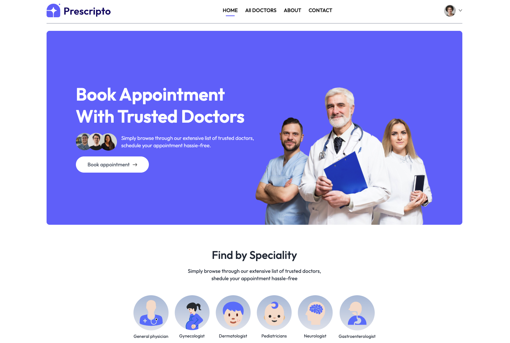

# Prescripto – Doctor Appointment Booking Website

An online appointment booking website for doctors and hospitals, built with **React JS** and **Tailwind CSS**.
Users can browse multiple doctors, filter them by speciality, then choose a date and time slot within a 7-day window to book an appointment.

> 🚧 **Work in progress.** The frontend is currently under development and the backend has not been started yet.



## Features

**Available now**
- Home page with hero banner and "Find by Speciality" section
- List of all doctors
- Filter doctors by speciality (General physician, Gynecologist, Dermatologist, Pediatricians, Neurologist, Gastroenterologist)
- Highlighted active speciality in the filter menu
- Responsive layout (mobile and desktop)

**Planned**
- Appointment page with date and time slot selection (7-day window)
- User authentication and profile
- "My appointments" page
- Backend with Node.js, Express and MongoDB
- Admin dashboard (manage bookings, create new doctor profiles)
- Doctor dashboard (manage profile, check bookings and earnings)

## Tech Stack

- [React JS](https://react.dev/)
- [React Router](https://reactrouter.com/)
- [Tailwind CSS](https://tailwindcss.com/)
- Context API for global state

Planned for the backend: Node.js, Express, MongoDB.

## Getting Started

```bash
# Clone the repository
git clone <your-repo-url>

# Go to the project folder
cd <your-project-folder>

# Install dependencies
npm install

# Start the development server
npm run dev
```

The app will be available at `http://localhost:5173`.

## Project Structure

```
src/
├── assets/        # Images, icons and doctors data (assets.js)
├── components/    # Reusable components (Navbar, Header, SpecialityMenu...)
├── context/       # AppContext
├── pages/         # Home, Doctors, About, Contact...
└── App.jsx
```

## Acknowledgements

This project is based on the [Doctor Appointment Booking Website tutorial by GreatStack](https://www.youtube.com/@GreatStackDev). Design, assets and project idea come from that tutorial, and I am building it as a learning project.
